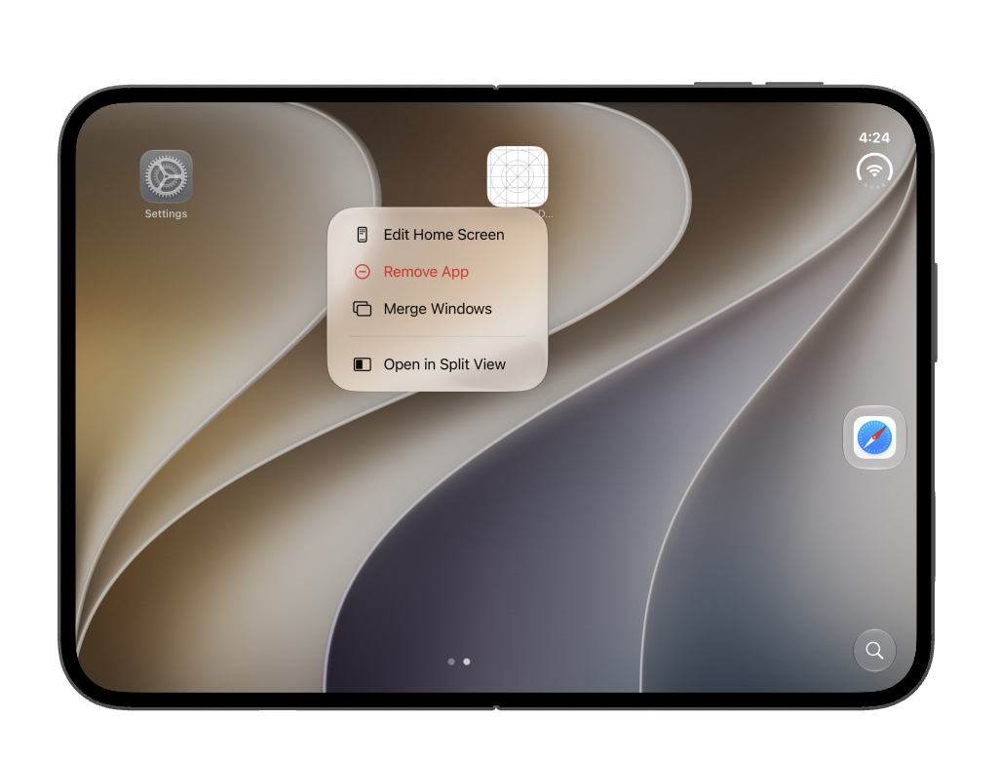
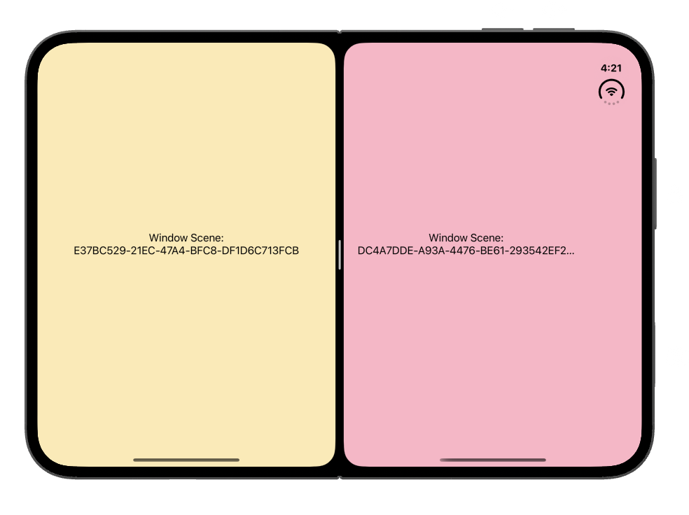
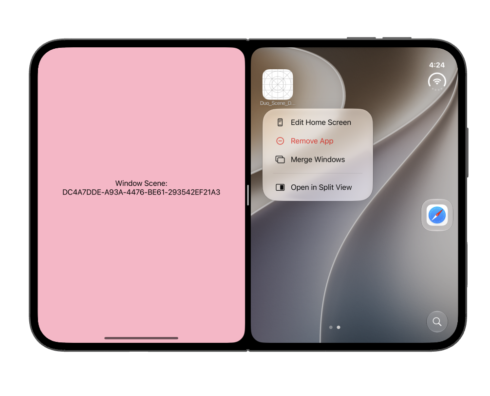
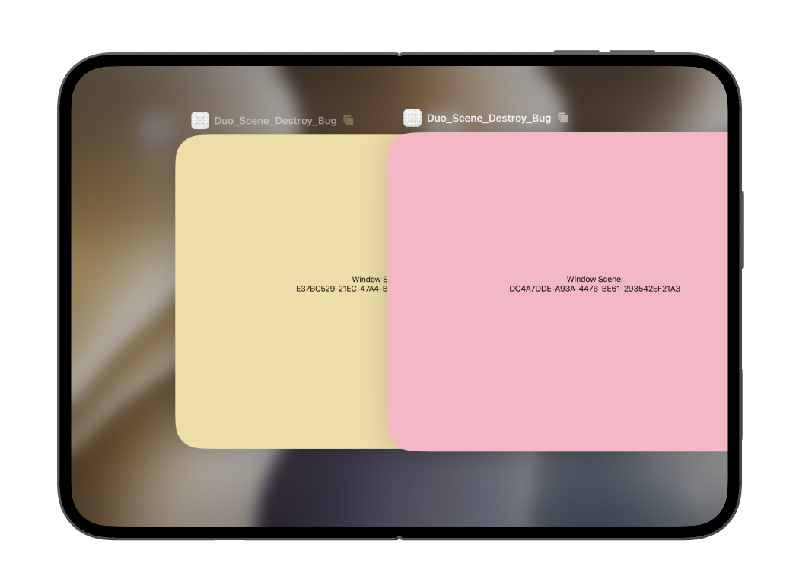
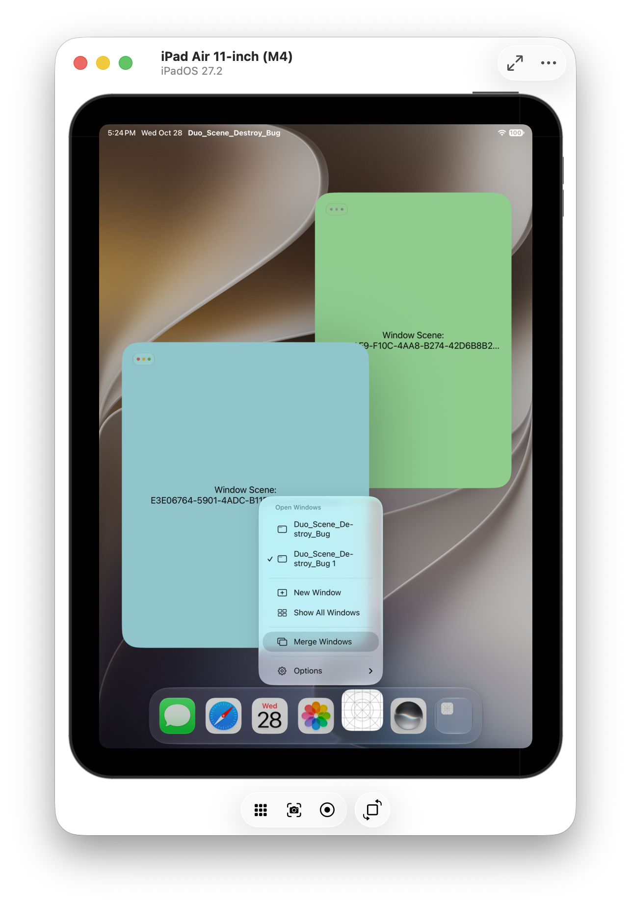
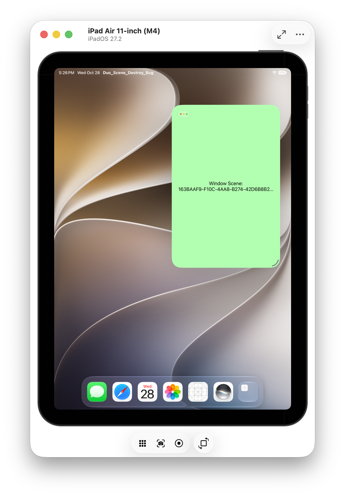

# Duo Scene Destroy Bug

This bug demo app has a feature for both iPad and iPhone Duo users who have opened two independent windows of the app using Duo [Split View](https://support.apple.com/en-ca/guide/iphone/iphrj13y9uxz/ios) or iPad [Multitask](https://support.apple.com/en-ca/125309). 

By tapping a quick action button, users can "merge" their open windows, copying data from all windows to a single window, then close all the extra windows.

However, on iPhone Duo, the call to [requestSceneSessionDestruction](https://developer.apple.com/documentation/uikit/uiapplication/requestscenesessiondestruction(_:options:errorhandler:)) to close the window we no longer need fails with the error `"This functionality is not supported for this device idiom."`. 

```
Error Domain=SBApplicationSupportService Code=1 "This functionality is not supported for this device idiom." UserInfo={NSLocalizedFailureReason=This functionality is not supported for this device idiom.}
```

## Steps to Reproduce

### 1. Open the app in Split View

Install the demo app. Unfold the Duo.

Long press the app icon and select the iPhone Duo system option, "Open in [Split View](https://support.apple.com/en-ca/guide/iphone/iphrj13y9uxz/ios)."



### 2. Open a second window of the app in Split View

Open a second window of the app so you have two side-by-side windows.



### 3. Test the "Merge Windows" feature

Long press the app icon and tap the "Merge Windows" option in the quick actions menu.



### 4. Bug: Cannot close second scene/window

On iPhone Duo, calling [requestSceneSessionDestruction](https://developer.apple.com/documentation/uikit/uiapplication/requestscenesessiondestruction(_:options:errorhandler:)) to close the window fails with the error `"This functionality is not supported for this device idiom."`. 

Both scenes remain active in the App Switcher.



Note: This code works on iPad for Multitask windows, as expected.



